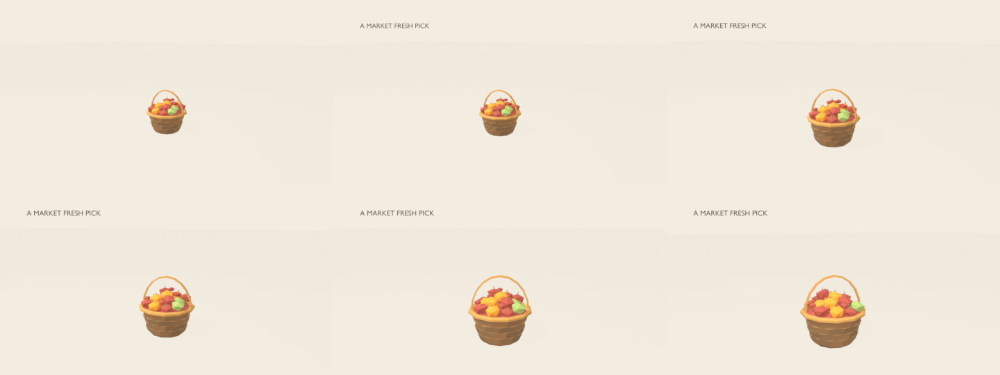
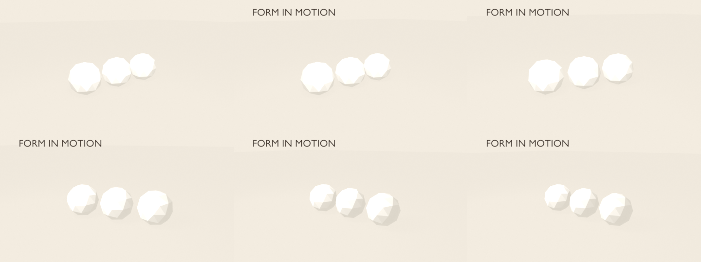

# Blockcut shot library

Three self-contained Blender shot specs. Start with a working composition and edit its prompt/spec, then render with:

```powershell
$blender = "C:/Users/naomi/Documents/vscode shenanigans/ManilaHack/bench3d/tools/blender-5.3.0-windows-x64/blender.exe"
& $blender -b --factory-startup -P shots/render_shot.py -- shots/library/<name>.json shots/out/<name> --proof
& $blender -b --factory-startup -P shots/render_shot.py -- shots/library/<name>.json shots/out/<name> --final
```

The final mode writes PNG frames and an H.264 MP4. Proof mode writes six sampled frames, a contact sheet, and exact sample times. Change the prompt first, then the JSON values for timings, camera keys, colors, or props. Specs use GLB paths relative to the repository root or Blender primitives. The sample basket comes from the existing `web/public/bench3d` asset library.

Select app output framing with `--aspect 9:16`, `--aspect 16:9`, `--aspect 1:1`, or `--aspect 4:5`. These produce 1080×1920, 1920×1080, 1080×1080, and 1080×1350 respectively; `--draft` writes half-resolution final frames/video for quicker iteration. The library specs use 30 fps. Each format passed the hero's six-frame proof (34/34 checks); encoded drafts verified at 540×960, 960×540, 540×540, and 540×674 (the last row trimmed for H.264 4:2:0).

| Shot | What it demonstrates | Prompt/spec | Thumbnail |
|---|---|---|---|
| **hero-orbit** | 10-second product hero: orbit, eased push-in at 6s, title at 1s, grounded basket on paper. Proof: 34/34 PASS, 30 fps. | [prompt](hero-orbit.prompt.md) · [spec](hero-orbit.json) |  |
| **reveal-rise** | Faceted object rises with easeOutBack and a slow camera tilt. Proof: 34/34 PASS, 30 fps. | [prompt](reveal-rise.prompt.md) · [spec](reveal-rise.json) |  |
| **flyby** | Camera dolly past three grounded props in a row. Proof: 90/90 PASS, 30 fps. | [prompt](flyby.prompt.md) · [spec](flyby.json) |  |

Generated proof frames, full-resolution PNG sequences and MP4s are in the git-ignored `shots/out/` directory. The contact sheet is deliberately low resolution; inspect the final MP4 for framing and movement.
